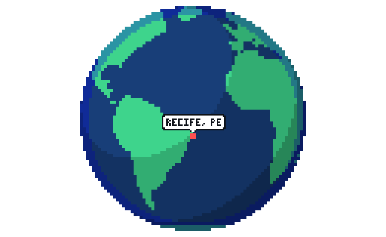
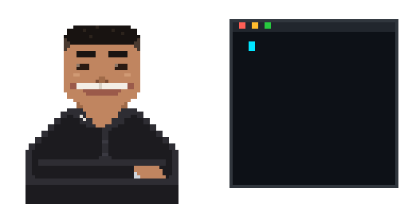
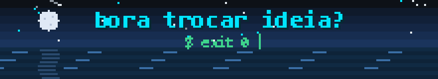

<div align="center">


<a href="https://github.com/lucasvfelinto">
  
</a>

<br/><br/>


<br/>


<br/><br/>

<a href="https://www.linkedin.com/in/lucasvfelinto/" target="_blank"></a>
<a href="https://lucas-felinto-curriculo_2022.surge.sh/" target="_blank"></a>
<a href = "mailto: lucas.felinto.office@gmail.com"></a>
<a href="https://instagram.com/lucasvfelinto" target="_blank"></a>
<a href="https://bento.me/lucasvfelinto" target="_blank"></a>

<br/><br/>


</div>

## Resumo

```yaml
nome:     Lucas Felinto
cargo:    Engenheiro de Software | IA Specialist @ GeoSistemas
local:    Recife, PE
foco:     sistemas com LLMs em produção: extração com modelos de visão, saída estruturada,
          RAG, MCP e fine-tuning
stack:    Python, TypeScript, React, Vue.js, Django, SQLite, PostgreSQL
formação: Ciência da Computação (UNICAP) · Pós em Engenharia de Software com IA (CESAR School, 2026–27)
```

Os sistemas em produção ficam em repositórios privados. O que segue descreve o que pode ser tornado público.

## Atuação

### Sistemas com LLMs · GeoSistemas

- **Extração de dados técnicos a partir de fotos e PDFs** com modelos de visão (Claude, GPT e Gemini): prompt com saída em JSON de schema fixo, validação estrita da resposta e rejeição de qualquer payload fora do schema.
- **Geração de artefatos:** planilhas `.xlsx` (openpyxl) e relatórios em PDF, com persistência em SQLite.
- **Seleção de modelo por benchmark:** comparação entre provedores sobre fotos reais com gabarito, medindo acurácia e custo por requisição. Cache de leituras elimina chamadas repetidas à API.
- **Reconciliação** da saída do sistema com as planilhas produzidas pela equipe, com métricas de acurácia, metas e retorno em horas.
- **Arquitetura híbrida em avaliação:** detector (YOLO) para localização e modelo de visão para leitura.
- **RAG, MCP e fine-tuning** em uso diário no desenvolvimento.

### Desenvolvimento web · Lunio

- **CRM com geração automatizada de propostas comerciais.** Front-end em Vue.js e API em Python/Django.
- **Reestruturação do `luniobr.com` em WordPress** e automações em n8n: formulários, e-mail e integrações de marketing.

### Back-end Java

- Spring Boot, PostgreSQL, Docker e Maven no projeto Unimpact (Unicap Icam TECH). Modelagem relacional no FitDB.

### Infraestrutura

- Redes, Windows Server, banco Totvs e Google Workspace (ABA Global Education e FINSOL México).

## Decisões de projeto: sistema de extração

| Camada | Escolha | Justificativa |
|---|---|---|
| Servidor | Python 3.11+, `ThreadingHTTPServer` da stdlib | Sem dependência de framework web: um único processo. |
| Persistência | SQLite | Arquivo único, sem serviço de banco para operar. |
| Documentos | `pypdfium2`, Pillow, numpy | Rasterização de PDF e pré-processamento da imagem antes da inferência. |
| Planilhas | openpyxl | Geração e comparação programática de `.xlsx`. |
| Front-end | React 19, Vite 7, roteamento por hash, CSS com variáveis | Roteamento client-side sem configuração de servidor. Tema centralizado, sem biblioteca de UI. |
| Segurança | Bind em localhost, senha opcional, header `X-App` obrigatório nos POSTs, CSP sem inline | Superfície de exposição mínima. O header customizado restringe os POSTs ao próprio front. |
| Segredos | Chave da API em `.env`, nunca enviada ao front | O segredo existe apenas no servidor. |
| Custo | Cache de leituras | Evita reprocessar a mesma imagem. |

## Stack

**Atual**


**Histórico**


**IA e automação**


<details>
<summary><b>Trajetória</b></summary>

- **2026–** GeoSistemas: Engenheiro de Software | IA Specialist. Sistemas e automações com IA para engenheiros projetistas.
- **2025–2026** Lunio: Desenvolvedor Web e depois Full Stack. WordPress e n8n; em seguida, CRM e propostas automatizadas (Vue.js, Python/Django).
- **2024** Unicap Icam TECH (Unimpact): estágio full stack com Java/Spring Boot, React, PostgreSQL, Docker e Maven.
- **2021–2024** Suporte e infraestrutura de TI: redes, Windows Server, Totvs e Google Workspace.
- **2019** CESAR School: estágio de desenvolvimento. Controle de presença com Python, C++ e Arduino.

</details>

## Atividade pública no GitHub

<div align="center">


<br/>

</div>

<picture>
  <source media="(prefers-color-scheme: dark)" srcset="https://raw.githubusercontent.com/lucasvfelinto/lucasvfelinto/output/github-snake-dark.svg" />
  
</picture>

<div align="center">

</div>
